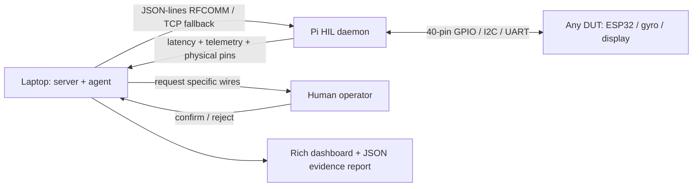
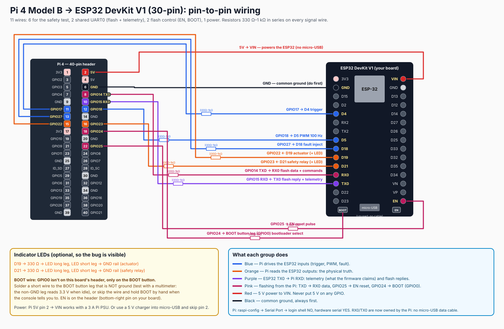

# Aperture OS

A universal **GPIO-only Hardware-in-the-Loop tester**. The laptop/server talks to
a Raspberry Pi over Bluetooth RFCOMM (TCP fallback); the Pi connects to any DUT
through its 40-pin header. The AI requests specific wires, a human confirms them,
and profile tests run only after every required connection is confirmed.
No USB link to the DUT. UART claims, when a profile has them, are checked against
independent GPIO evidence. Everything also runs offline with simulated hardware.



## Quickstart (Python 3.10+)

```sh
python -m venv .venv
. .venv/bin/activate
pip install -e '.[dev]'
```

End-to-end in two commands (separate terminals, activated venv):

```sh
aperture-daemon --backend sim
aperture-agent --report report.json
```

Or **`make demo`**: starts an in-process simulated daemon on an ephemeral TCP port,
runs the real agent CLI, checks that a discrepancy was caught, then shuts down.
The agent exits **1** for detected safety violations; the demo exits **0** only when
the expected bug was caught. `aperture-daemon --fixed` simulates a repaired build;
the offline agent then passes and exits 0. No API key, Bluetooth or hardware required.

## Aperture OS Console

```sh
pip install -e '.[dev]'  # refresh console entry points after updating
aperture-ui --port 8080
```

Open **http://localhost:8080**. The offline, dark-themed console starts its own
simulated TCP harness: no separate daemon, CDN, API key or frontend build needed.
Choose a profile in the Current session sidebar. Yellow header pins and inline
cards request specific wires; click **Connected ✓** on each after wiring. The last
confirmation starts the tests automatically. ESP32 safety exposes the red
**FIRMWARE LIED** alert; its chat cards retain claim/readback evidence even after
the rig recovers to idle. The transport indicator opens settings; switch DEMO_BUG
off and reconnect to contrast a fixed simulated rig.

Click any GPIO pin to open its live waveform. LOW is light grey, HIGH is green,
pending requests pulse yellow, and unwired pins are outline-only. TX/RX badges
separate Pi transmit from receiving. Gyroscope decoded axes appear beside GPIO24
and in its waveform. Previous session evidence is saved locally in the browser;
select Current session to resume control. New session / Reset releases previous
GPIO configuration and requests wiring again. Export JSON and the collapsible wire
log preserve the raw evidence, with level filtering, pause and clear.

The copilot accepts full plans, trigger high/low, PWM N%, inject/clear fault,
read state and reset to idle. If `OPENAI_API_KEY` is set, prompts go to the existing
LLM tool loop (`pip install -e '.[llm]'`); `OPENAI_MODEL` optionally selects a model.
Tool observations, reasoning, raw TX/RX JSON, UTC timestamps and measured round-trip
latency stream over SSE. Filter, pause or clear the wire log; export the latest
JSON report. Logs retain the most recent 1,000 events in memory, not on disk.

For an existing harness: `aperture-ui --backend-mode tcp --host <Pi-IP>
--daemon-port 8765`; for RFCOMM use `--backend-mode rfcomm --host <Pi-MAC>
--daemon-port 1`. The HTTP server binds to loopback only. This is a single-operator
local console, not an authenticated multiuser control plane; concurrent writes
return 409. Use it only with trusted local users and a safe bench load.

HTTP API: `GET /api/state`, `/api/report`, `/api/events` (SSE);
`POST /api/prompt` with `{"prompt":"Run full safety plan"}`;
`POST /api/connect` with `{"mode":"sim","host":"127.0.0.1","port":8765,
"demo_bug":true}`. API failures use JSON `error` and HTTP 400/409/502; a completed
test with a detected firmware fault returns HTTP 200 and `report.pass:false`.

## Universal profiles and human wiring workflow

```sh
aperture-ui --profile mpu6050_gyro --port 8080  # own simulated harness
# Laptop connecting to real Pi (pair/trust first):
aperture-ui --backend-mode rfcomm --host <Pi-MAC> --daemon-port 1 --profile mpu6050_gyro
```

The console supports all three profiles with human-confirmed wiring. The legacy
API remains backward-compatible without a selected profile; the new console's
profile picker and test chips select a profile before driving a DUT.

```sh
curl -s localhost:8080/api/profiles/select -H 'Content-Type: application/json' -d '{"profile":"mpu6050_gyro"}'
curl -s localhost:8080/api/requests
# After physically wiring each requested pin (SDA/SCL/INT), confirm each:
curl -s localhost:8080/api/requests/confirm -H 'Content-Type: application/json' -d '{"pi_pin":2}'
curl -s localhost:8080/api/requests/confirm -H 'Content-Type: application/json' -d '{"pi_pin":3}'
curl -s localhost:8080/api/requests/confirm -H 'Content-Type: application/json' -d '{"pi_pin":24}'
curl -s localhost:8080/api/profiles/run -H 'Content-Type: application/json' -d '{}'
```

`profiles/*.json` describe wiring and expectations:

* `esp32_safety`: GPIO stimulus/readback plus header UART. Planted relay bug still
  produces a discrepancy; fixed sim/build passes. New runner uses generic commands.
* `mpu6050_gyro`: GPIO2 SDA / GPIO3 SCL (I2C bus 1, AD0 low/address 0x68), GPIO24 INT.
  WHO_AM_I, data-ready transitions and angular velocity ±250 deg/s expectations.
  Real adapter wakes/configures the sensor and lazily opens smbus2. SDA/SCL are
  peripheral-owned bidirectional/open-drain signals, never push-pull GPIO outputs.
* `display`: observes four data pins (5/6/13/19) and strobe (26) from a DUT that
  continuously presents binary number 5. A concrete example, not a universal display driver.

Every profile assumes separately supplied, safe 3.3V power and common ground.
No GPIO request may target power/GND or reserved ID_SD/ID_SC. Confirmations record
operator intent, not electrical continuity. They reset on profile change/reconnect.
Profile runs return `waiting_for_connections` without touching hardware if wires
are missing/rejected; confirm and explicitly run again. History is bounded to 512
samples per pin. Real timing is best-effort, not suitable for high-frequency capture.

Offline prompts include “test the gyroscope”, “test the display”, “connect GPIO17
to ESP32 GPIO4” and “read pin 24”. API/LLM tools configure confirmed custom wires,
read, write and sample; only human HTTP endpoints can confirm. The LLM is given
generic GPIO and profile-selection tools rather than ESP32 assumptions.
The CLI `aperture-agent --profile display` also requests confirmation
in the terminal before running; do not automatically confirm real wiring.

See [protocol and API reference](docs/protocol.md) for full header states, request,
profile, waveform endpoints and SSE payloads. GPIO adapters are lazy; a real daemon
starts without opening a DUT UART unless the ESP32 profile actually reads it.

## Wiring (Pi numbering is BCM)



| Signal | Raspberry Pi | ESP32 DevKit V1 label | Direction / purpose |
|---|---|---|---|
| Common ground | GND physical pin 6 | GND | Shared reference, wire first |
| Power (optional) | 5V physical pin 2 | VIN | Powers the ESP32 from the Pi; or use a 5 V charger on micro-USB |
| Digital trigger | GPIO17, physical 11 | D4 | Pi → DUT sensor / trigger |
| PWM | GPIO18, physical 12 | D5 | Pi → DUT 100 Hz duty |
| Fault | GPIO27, physical 13 | D18 | Pi → DUT active-high fault |
| Actuator readback | GPIO22, physical 15 | D19 | DUT → Pi (+ optional LED to GND) |
| Safety readback | GPIO23, physical 16 | D21 | DUT → Pi, high = armed (+ optional LED to GND) |
| UART0 RX | GPIO15 RXD, physical 10 | TX0 | DUT → Pi: JSON telemetry 115200 and esptool replies |
| UART0 TX | GPIO14 TXD, physical 8 | RX0 | Pi → DUT: esptool flash data |
| Reset (flash only) | GPIO25, physical 22 | EN | Pi pulses LOW to reset the ESP32 |
| Boot select (flash only) | GPIO24, physical 18 | BOOT button leg (GPIO0) | Held LOW through reset to enter the ROM bootloader |

**3.3 V only.** Share ground; use 330 Ω–1 kΩ series resistors. Disconnect power
before wiring. Never connect 5 V signals. Do not drive motors/relays directly from
GPIO: use suitable buffered, protected drivers and a separate load supply.
This demo is not a certified safety system; test with LEDs before real loads.

The 30-pin DevKit V1 does not expose GPIO0 on its header: solder a short wire to the
non-ground leg of the BOOT button, or leave the GPIO24 wire out and hold BOOT by hand
when flashing with *manual boot*. EN and BOOT are `optional` profile wires: tests run
without them, flashing requires them (BOOT unless manual).

### Demo parts

1× Raspberry Pi 4 Model B (any Pi with the 40-pin header; Pi 5 may need a different gpiozero
pin factory), 1× ESP32 DevKit V1 (30-pin, `esp32dev`), 1× breadboard, ~10 female–male and
~10 male–male jumpers, 9× 330 Ω–1 kΩ resistors for the signal wires, 2× LEDs + 2× 330 Ω for
the D19/D21 indicators, a 5 V supply for the ESP32 (Pi 5V pin with a 3 A Pi PSU, or a
charger on micro-USB without a data connection) and a laptop running `aperture-ui`
(Linux for Bluetooth RFCOMM, any OS over TCP).

## Firmware and hardware

```sh
pip install platformio
pio run -d firmware/esp32 -e esp32dev   # DEMO_BUG=1 build → firmware/esp32/.pio/build/esp32dev/
pio run -d firmware/esp32 -e fixed      # DEMO_BUG=0 build
pip install -e '.[pi]'                  # on the Pi: gpiozero, pyserial, smbus2, esptool
aperture-daemon --backend real --serial-port /dev/serial0 --profile esp32_safety
```

### Flashing over the Pi header (no micro-USB)

The laptop never touches the ESP32. `aperture-ui` (sidebar **ESP32 firmware** panel, the
*Flash fixed firmware* chip, or a prompt such as "flash the fixed firmware") and
`aperture-agent --flash esp32dev|fixed` read the PlatformIO artifacts
(`bootloader.bin` @0x1000, `partitions.bin` @0x8000, `boot_app0.bin` @0xE000 when the
Arduino framework is installed, `firmware.bin` @0x10000), stream them to the daemon in
48 KiB base64 chunks with SHA-256 manifests (`flash_begin` / `flash_chunk` / `flash_run`),
and the Pi runs `esptool --before no_reset --after no_reset write_flash` on `/dev/serial0`
while driving the control pins itself: GPIO24 (BOOT/GPIO0) LOW, GPIO25 (EN) pulsed LOW→HIGH,
write, then BOOT released and EN pulsed again to boot the new image. Both pins are released
to the ESP32's own pull-ups afterwards. *Manual boot* skips the GPIO24 wire: hold the BOOT
button while the console resets the board. The firmware embeds
`APERTURE_BUILD esp32_safety DEMO_BUG=<0|1>`; the daemon reports it as `build_tag`, and the
simulated harness switches its planted bug on or off from that tag so the flash → re-verify
loop can be rehearsed without hardware. Tick *Build with PlatformIO first* to run `pio run`
from the console (PlatformIO must be installed on the laptop).

UART0 is shared: the same TX0/RX0 wires carry the JSON telemetry at 115200 baud during tests
and esptool traffic while flashing, so the micro-USB port stays empty (power it from VIN or a
charger without data). Enable the Pi UART and disable its login console on `/dev/serial0`,
and enable I2C for gyro profiles (`raspi-config`). Avoid claiming pins already used by system
services/HATs. Pi supply pins must not power loads outside the board's ratings.

Normal trigger drives GPIO19; duty >80% throttles (actuator LOW). Fault has highest
priority, and claims both outputs LOW. IDLE and recovery re-arm GPIO21 HIGH.
Telemetry is emitted every 50 ms plus up to 25 ms PWM measurement wait.
PWM is fixed at 100 Hz; this is a sampled duty estimator, not a precision meter.
The intentionally planted bug skips the physical GPIO21 write on fault if **trigger
is HIGH OR PWM >80%**. This unifies both scenarios in the supplied specification.
It retains the previous safety level: testing from an already-shutdown state can mask it.
Both builds report the intended output state in Serial; only readback proves reality.

## Agent modes

Offline mode executes Nominal, High Load, Edge-Case Glitch, Fault Recovery,
fault-while-trigger, and final idle cleanup, recording every observation.
The edge-case is a held fault vector, not a sub-millisecond glitch generator.

```sh
pip install -e '.[llm]'
export OPENAI_API_KEY=...  # never put credentials in source
# Optional OPENAI_BASE_URL for an OpenAI-compatible endpoint
aperture-agent --llm --model gpt-4o-mini
```

The legacy CLI loop exposes `stimulate_hardware`, `read_hardware_state`,
and `inject_hardware_fault`; selected-profile CLI and console LLM use generic
request/configure/read/write/sample/run tools instead. Every profile gets deterministic checks;
an LLM cannot override a detected violation. LLM plan coverage is not guaranteed;
use offline mode for repeatable regression coverage. Fault and PWM are deasserted
at legacy LLM completion and after safety-profile runs. Custom GPIO tool output
levels remain until explicitly changed/released; always reset real hardware.
Reports contain measured evidence, timing, reasoning and verdicts.

## Transport and hackathon fallback

TCP defaults to loopback port 8765. For another laptop use `--host <Pi-LAN-IP>` on
the daemon and agent. This is **unauthenticated lab-only TCP**; never expose it to
the internet. Use an SSH tunnel for untrusted networks.

Optional Linux RFCOMM uses Python's native Bluetooth socket support, no BLE/GATT:
pair/trust the devices in BlueZ first, then run daemon `--rfcomm <Pi-adapter-MAC>
--channel 1`, agent `--rfcomm --host <Pi-adapter-MAC> --port 1`. SDP advertisement
is not provided; connect to the explicit channel. OS permissions and pairing are
operator responsibilities. If Bluetooth takes 20 minutes, pivot to TCP or run the
agent on the Pi. If hardware fails, show `make demo`, then `--fixed` to contrast.
Real GPIO, serial hardware, radio pairing and firmware flashing require bench validation.

## Development

`ruff check . && pytest -q`; `make demo`. See [protocol](docs/protocol.md).
Tests use real loopback TCP sockets and no hardware/credentials. The simulated
backend models state/pin behavior, not electrical timing or transient races.
Latency is host command-to-observation wall time, not an oscilloscope measurement.
