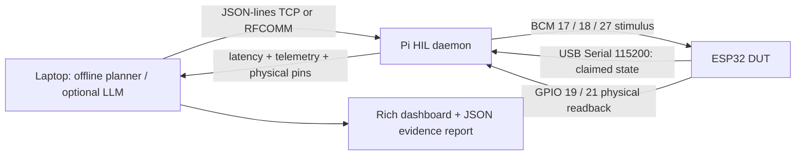

# Aperture OS

An autonomous Hardware-in-the-Loop safety verifier: **Serial is a claim, GPIO is evidence.**
Runs fully offline on a laptop, or drives a Raspberry Pi wired to an ESP32 DUT.
The deterministic plan catches firmware that reports shutdown but leaves the safety relay high.



## Quickstart (Python 3.10+)

```sh
python -m venv .venv
. .venv/bin/activate
pip install -e '.[dev]'
```

End-to-end in two commands (separate terminals, activated venv):

```sh
aperture-daemon --backend sim
aperture-agent --report report.json
```

Or **`make demo`**: starts an in-process simulated daemon on an ephemeral TCP port,
runs the real agent CLI, checks that a discrepancy was caught, then shuts down.
The agent exits **1** for detected safety violations; the demo exits **0** only when
the expected bug was caught. `aperture-daemon --fixed` simulates a repaired build;
the offline agent then passes and exits 0. No API key, Bluetooth or hardware required.

## Wiring (Pi numbering is BCM)

| Signal | Raspberry Pi | ESP32 | Direction / purpose |
|---|---|---|---|
| Common ground | GND physical pin 6 | GND | Shared reference |
| USB | USB-A | USB-C / Micro USB | Power, flashing, Serial `/dev/ttyUSB0` |
| Digital trigger | GPIO17, physical 11 | GPIO4 | Pi → DUT sensor / trigger |
| PWM | GPIO18, physical 12 | GPIO5 | Pi → DUT 100 Hz duty |
| Fault | GPIO27, physical 13 | GPIO18 | Pi → DUT active-high fault |
| Actuator readback | GPIO22, physical 15 | GPIO19 | DUT → Pi |
| Safety readback | GPIO23, physical 16 | GPIO21 | DUT → Pi, high = armed |

**3.3 V only.** Share ground; use 330 Ω–1 kΩ series resistors. Disconnect power
before wiring. Never connect 5 V signals. Do not drive motors/relays directly from
GPIO: use suitable buffered, protected drivers and a separate load supply.
This demo is not a certified safety system; test with LEDs before real loads.

## Firmware and hardware

```sh
pip install platformio
pio run -d firmware/esp32 -e esp32dev -t upload  # DEMO_BUG=1
pio run -d firmware/esp32 -e fixed -t upload     # DEMO_BUG=0
pip install -e '.[pi]'
aperture-daemon --backend real --serial-port /dev/ttyUSB0
```

Normal trigger drives GPIO19; duty >80% throttles (actuator LOW). Fault has highest
priority, and claims both outputs LOW. IDLE and recovery re-arm GPIO21 HIGH.
Telemetry is emitted every 50 ms plus up to 25 ms PWM measurement wait.
PWM is fixed at 100 Hz; this is a sampled duty estimator, not a precision meter.
The intentionally planted bug skips the physical GPIO21 write on fault if **trigger
is HIGH OR PWM >80%**. This unifies both scenarios in the supplied specification.
It retains the previous safety level: testing from an already-shutdown state can mask it.
Both builds report the intended output state in Serial; only readback proves reality.

## Agent modes

Offline mode executes Nominal, High Load, Edge-Case Glitch, Fault Recovery,
fault-while-trigger, and final idle cleanup, recording every observation.
The edge-case is a held fault vector, not a sub-millisecond glitch generator.

```sh
pip install -e '.[llm]'
export OPENAI_API_KEY=...  # never put credentials in source
# Optional OPENAI_BASE_URL for an OpenAI-compatible endpoint
aperture-agent --llm --model gpt-4o-mini
```

The bounded tool-calling loop exposes `stimulate_hardware`, `read_hardware_state`,
and `inject_hardware_fault`. Every measurement gets deterministic cross-checks;
an LLM cannot override a detected violation. LLM plan coverage is not guaranteed;
use offline mode for repeatable regression coverage. Fault and PWM are deasserted
at LLM completion. Reports contain pins, telemetry, timing, reasoning and verdicts.

## Transport and hackathon fallback

TCP defaults to loopback port 8765. For another laptop use `--host <Pi-LAN-IP>` on
the daemon and agent. This is **unauthenticated lab-only TCP**; never expose it to
the internet. Use an SSH tunnel for untrusted networks.

Optional Linux RFCOMM uses Python's native Bluetooth socket support, no BLE/GATT:
pair/trust the devices in BlueZ first, then run daemon `--rfcomm <Pi-adapter-MAC>
--channel 1`, agent `--rfcomm --host <Pi-adapter-MAC> --port 1`. SDP advertisement
is not provided; connect to the explicit channel. OS permissions and pairing are
operator responsibilities. If Bluetooth takes 20 minutes, pivot to TCP or run the
agent on the Pi. If hardware fails, show `make demo`, then `--fixed` to contrast.
Real GPIO, serial hardware, radio pairing and firmware flashing require bench validation.

## Development

`ruff check . && pytest -q`; `make demo`. See [protocol](docs/protocol.md).
Tests use real loopback TCP sockets and no hardware/credentials. The simulated
backend models state/pin behavior, not electrical timing or transient races.
Latency is host command-to-observation wall time, not an oscilloscope measurement.
